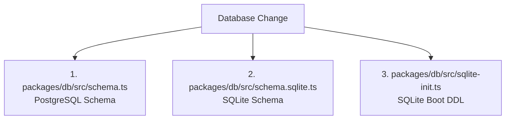

# AI Agent & Core Developer Guide

> [!IMPORTANT]
> **MANDATORY READING FOR AI CODING AGENTS & HUMAN CONTRIBUTORS**
> This repository uses a dual-engine architecture to support both a **cloud multi-tenant offering (PostgreSQL)** and a **zero-dependency single binary (SQLite)**. Breaking parity between these two engines will cause production crashes in either the web deployment or the standalone executable.

---

## 1. Rule #1: The Dual-Database Parity Rule

Whenever you add, modify, or delete a table, column, enum, or relation, you **must update three places**:



### 1. `packages/db/src/schema.ts` (PostgreSQL)
The source of truth for the cloud PostgreSQL offering. Uses `drizzle-orm/pg-core` (`pgTable`, `uuid`, `timestamp`, `numeric`, `jsonb`, etc.).

### 2. `packages/db/src/schema.sqlite.ts` (SQLite)
The source of truth for the local SQLite database. Uses `drizzle-orm/sqlite-core` (`sqliteTable`, `text`, `integer`).

### 3. `packages/db/src/sqlite-init.ts` (Raw DDL Execution)
SQLite databases in MoMoney are bootstrapped on the fly without running an external migration CLI. When the SQLite database boots, `initSqliteDatabase()` executes raw DDL statements (`CREATE TABLE IF NOT EXISTS`, `CREATE INDEX IF NOT EXISTS`). If you add a column or table, you **must** append it here.

### 4. `packages/db/src/index.ts`
Export the table from `src/index.ts` using the polymorphic conditional export:
```typescript
export const myTable = (isSqlite ? sqliteSchema.myTable : pgSchema.myTable) as typeof pgSchema.myTable
```
*(Typing as `typeof pgSchema.myTable` ensures all backend TypeScript checks compile identically across both engines)*.

---

## 2. Rule #2: SQL Dialect Portability

Do **not** write PostgreSQL-specific or SQLite-specific SQL directly in application services without a conditional branch.

### Case 1: Date Formatting
❌ **Wrong** (Fails in SQLite):
```typescript
sql`to_char(${transactions.date}, 'YYYY-MM')`
```
✅ **Correct**:
```typescript
import { isSqlite } from '@momoney/db'

const monthExpr = isSqlite
  ? sql<string>`strftime('%Y-%m', datetime(${transactions.date} / 1000, 'unixepoch'))`
  : sql<string>`to_char(${transactions.date}, 'YYYY-MM')`
```

### Case 2: Case-Insensitive String Matching
❌ **Wrong** (Fails in SQLite):
```typescript
ilike(transactions.description, `%${query}%`)
```
✅ **Correct**:
```typescript
import { isSqlite } from '@momoney/db'
import { ilike, like } from 'drizzle-orm'

const searchFilter = isSqlite
  ? like(transactions.description, `%${query}%`)
  : ilike(transactions.description, `%${query}%`)
```

### Case 3: Type Casting
❌ **Wrong** (PostgreSQL-only cast syntax):
```typescript
sql`count(*)::int`
```
✅ **Correct**:
```typescript
sql<number>`count(*)`
```

---

## 3. Rule #3: Authentication & Local Mode

MoMoney operates in two authentication modes:

| Mode | Trigger | Behavior |
| :--- | :--- | :--- |
| **Cloud Mode** | PostgreSQL active | Full multi-tenant authentication via Better Auth. Requires email verification, password hashing, and session tokens stored in the `sessions` table. |
| **Local Mode** | SQLite active or `MOMONEY_LOCAL_MODE=true` | Zero-login mode. `authMiddleware` and `/api/auth/get-session` automatically provision and return a pre-seeded local user (`LOCAL_USER_ID = '00000000-0000-0000-0000-000000000001'`). Email verification checks are bypassed. |

**Agent Requirement**:
When creating new API endpoints:
- Always use `authMiddleware` to protect user-scoped routes.
- Access the user ID via `c.get('userId')`.
- Do not make external assumptions about session cookies being set, as local mode injects the session programmatically in memory.

---

## 4. Rule #4: Frontend Static Export (`apps/web`)

The standalone single binary embeds the Next.js frontend into the binary itself. This requires Next.js to export static files (`NEXT_OUTPUT_EXPORT=true`).

### Suspense Boundaries for Query Parameters
Any page using `useSearchParams()` must be wrapped in a `<Suspense>` boundary. If missing, `next build` will throw:
`Page with useSearchParams() must be wrapped in a <Suspense> boundary during static export.`

### Relative URLs for Embedded API Calls
In the browser, API calls must use relative paths when bundled in standalone mode:
```typescript
const baseURL = process.env.NEXT_PUBLIC_API_URL ?? 'http://localhost:3001'
// When NEXT_PUBLIC_API_URL is empty string "", fetch(`${baseURL}/api/...`) resolves to relative /api/...
```

---

## 5. Rule #5: Polyfill Hoisting in Bun Standalone

Node and Bun have different module systems for headless canvas (used by PDF/image parsers).

In `apps/api/src/standalone.ts`, polyfills **must** be loaded in a separate module (`import './polyfill.js'`) at the very top of the file before any other imports. Because ESM hoists `import` statements above inline code, attempting to mock `window` or `document` inline inside `standalone.ts` will execute *after* the parsers load, resulting in crashes.

---

## 6. Pre-Commit Checklist for AI Agents

Before declaring any database or feature task complete, run:

1. **Type Check**:
   ```bash
   pnpm type-check
   ```
2. **Verify SQLite Execution**:
   ```bash
   DB_DIALECT=sqlite pnpm --filter @momoney/api exec tsx -e "import { db } from '@momoney/db'; console.log('DB OK');"
   ```
3. **Verify Binary Build**:
   ```bash
   bun build apps/api/src/standalone.ts --compile --outfile dist/momoney
   ```
