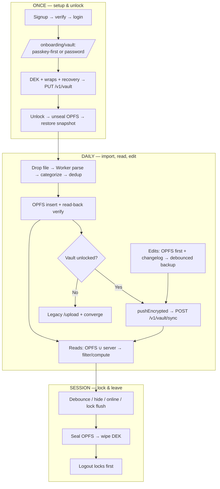

# Code Walkthrough: local-first super-secure (branch `super-secure` vs `main` @ `f6e215c`)

> ~77 files, ~12.5k insertions. This series walks every new/changed file by feature area.
> Convention: `path` + what it does + the 2–3 functions that matter + gotchas. Line refs are
> approximate (code moves); symbol names are the stable anchors.
> Start here, then 01 → 08 in order. Design rationale lives in `docs/dev/done/001–004`.

- [01 — `@momoney/local-engine`](01-local-engine.md) — isomorphic core: types, dedup, analytics, invoices, SQL builders, storage seam, crypto.
- [02 — Browser-safe parsers](02-parsers-browser.md) — PDF line extraction, browser entry, xlsx interop, dist builds.
- [03 — Vault, crypto & sync](03-vault-crypto-sync.md) — API routes, envelope crypto, PRF, sync client, store, onboarding wizard.
- [04 — OPFS database](04-opfs-database.md) — workers, facade, seal/unseal, boot handshake, hardening saga.
- [05 — Reads](05-reads.md) — merged input, local query, invoice composer, adapter, dashboard.
- [06 — Mutations & backup](06-mutations-sync.md) — vault-gated edits, changelog, triggers, pending tracking.
- [07 — UI flows](07-ui-flows.md) — statements, invoices, transactions store, vault page, banners, landing/privacy.
- [08 — DB migrations](08-db-migrations.md) — `vault_blobs`, `vault_wraps`, drift fix, workflow.

## Entire lifecycle (one diagram)

** debts / sharp edges (indexed, details in 01–08):** `vaultBlobs→vaultWraps` needs separate queries (no direct FK) · PRF salt encoding must normalize base64 variants · `beforeunload` backup is best-effort · `PUT /v1/vault` is full-replace (only `/sync` is concurrency-safe) · `public/wa-sqlite-async.wasm` is vendored stock SQLite (no cipher inside).
