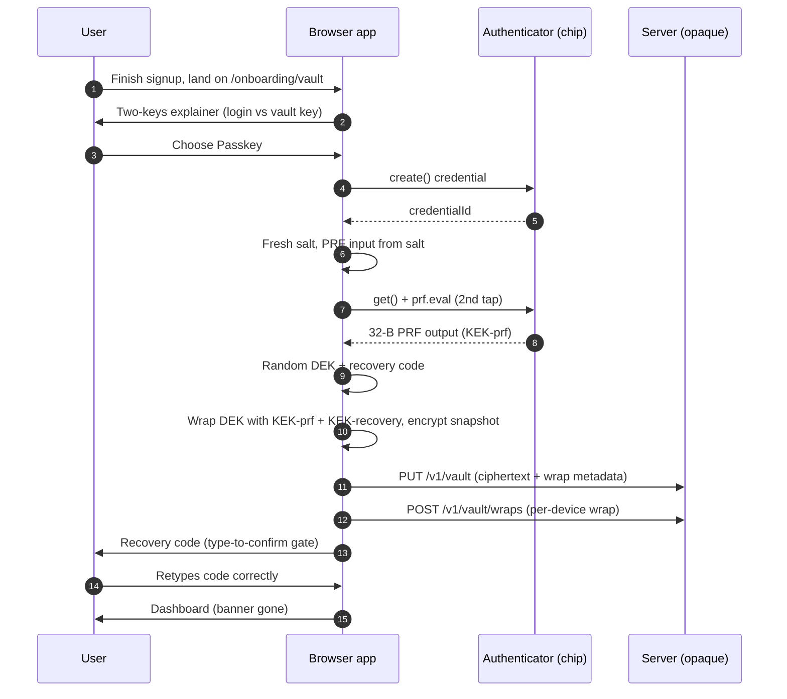
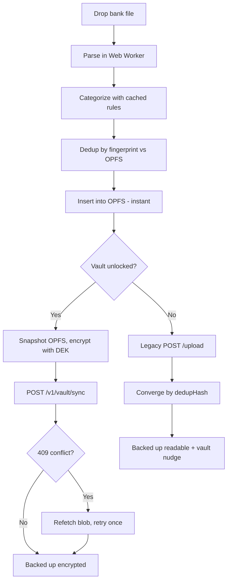
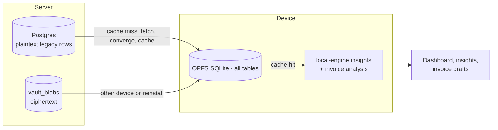
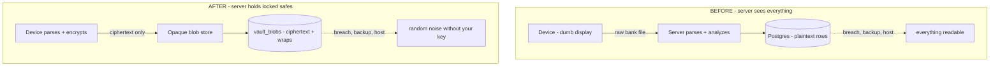

# DONE 002: Encrypted Backup, Multi-Device Wraps & Vault Onboarding

**Date:** 2026-09-27
**Status:** Shipped on `super-secure` (`5a76191` → `014cc3e`)
**Category:** Architecture / Privacy / Onboarding
**Tags:** `#privacy` `#zero-knowledge` `#webauthn-prf` `#onboarding` `#optimistic-concurrency`
**Follows:** `001-local-first-encrypted-vault.md` (read that first; same 🧠 ELI5 convention)

---

## 1. The problem

DONE 001 ended with an honest hole: the vault existed and the sync primitive worked, but the **daily backup path still sent raw bank files** to `POST /v1/statements/upload`, which the server parsed into **plaintext rows**. Key custody without an encrypted transport is a safe with the back panel missing. Additionally, the wrap model allowed exactly **one passkey** (PRF output is device-bound, so a second device could never unlock), and vault setup lived in Settings where new users never go.

> 🧠 **ELI5:** last time we built you an armored truck (encrypted vault) — but the daily cash delivery still went by bicycle with money taped to the handlebars (file upload). We also cut only **one** spare key (single passkey), and hid the whole key-cutting shop in a back room (Settings). This round: all deliveries go by truck, every family member gets their own key, and the shop moved to the front door (onboarding).

---

## 2. What changed

### 2a. Encrypted backup endpoint (`5a76191`)

- **New `POST /v1/vault/sync`**: accepts `{cipher, nonce, baseVersion}` — already-encrypted bytes only. No parsing, no categorization, no plaintext code path by construction. **Optimistic concurrency**: wrong `baseVersion` → `409 CONFLICT`, version auto-increments server-side, so stale writes can never silently overwrite.
- **Client switch-over** (`vault.store.pushEncrypted`): snapshots the OPFS cache, encrypts with the in-memory DEK, posts ciphertext, refetches-and-retries once on conflict. Statement import now branches — **vault unlocked → encrypted backup** ("the server sees only ciphertext"); otherwise the legacy file upload. Pending backups persist in `localStorage` (`momoney_pending_backup`) and drive the history badge, so "On-device" now strictly means *no backup of any kind has landed*.
- **E2E** (`vault-e2e.mts`): sync round-trip, stale-write conflict safety, then delete.

> 🧠 **ELI5 — optimistic concurrency:** two phones backing up at once could clobber each other. The fix is a coat-check ticket: every backup says "I'm updating ticket #5." If the counter already moved to #6 (someone else got there first), the clerk refuses and you re-check your bag against the latest before trying again. Nobody's data is silently lost — the worst case is one extra retry.

### 2b. Multi-device passkey wraps (`014cc3e`)

- **New `vault_wraps` table**: composite PK `(userId, credentialId)`, cascade delete. Migration `0007` preserves any legacy single-device wraps before dropping the old `wrapped_dek_prf` / `prf_credential_id` columns.
- **API**: `POST`/`DELETE /v1/vault/wraps`, wraps embedded in `GET /v1/vault`. E2E proves register → list → per-device unwrap → cross-unwrap rejection → revoke.
- **UI**: device list with labels + added-dates, revoke buttons, device picker at unlock, per-device labels at registration (with OS/browser auto-suggest).
- **Two real bugs caught by the E2E:**
  1. Drizzle cannot infer `vaultBlobs→vaultWraps` as a relational `with` (shared `userId`, no direct FK) — routes fetch wraps with a separate query. Documented in `CLAUDE.md`.
  2. A base64-variant bug: vault salts are standard-base64 but the PRF-input decoder expected base64url, silently corrupting inputs containing `+/=`. Fixed in `derivePrfInput` (normalize first). This would have bricked passkey unlock for ~1 in 3 vaults — exactly why the E2E exists.

> 🧠 **ELI5 — why one row per device:** your face unlocks *your phone's* chip, and each chip produces *different* secret bytes. So each device needs its own separately-wrapped copy of the master key — like cutting a distinct spare key per family member. The server holds labeled envelopes ("MacBook", "Pixel") it cannot open; revoking a device is throwing its envelope away. (Full DEK rotation after a theft is still backlog — revocation stops *future* unlocks from that device.)

### 2c. Guided vault onboarding (`014cc3e`)

- **New `/onboarding/vault` wizard**: two-keys explainer (login proves *who you are*; vault key keeps *what's yours* unreadable) → passkey-first incl. true **passwordless setup** (DEK + PRF wrap + recovery, no password stored) or password path → recovery code with **type-to-confirm gate**.
- Setup encrypts **current OPFS data**, so existing users' history is protected, not just new imports. Existing vaults redirect away; dashboard redirects first-timers here (skippable per session) and otherwise shows a nudge banner.
- New store primitive `adoptSession` (adopt an already-created session) and generalized `setupVaultWithPasskeys` (caller-provided Argon2 params so the PRF input can be derived from the salt *before* setup).

> 🧠 **ELI5 — the two-password problem:** users have one mental slot for "my password." We explain it as two jobs, not two passwords: the login is your *ID badge* (the building checks it), the vault key is your *safe combination* (even the building manager doesn't know it). Passkey-first means most users never type a second secret at all — and the recovery-code ceremony (retype it to proceed) exists because "I saved it" clicks are cheap and lost keys are forever.

---

## 3. Privacy delta vs DONE 001

| Before (001) | After (002) |
|---|---|
| Backups walked in as plaintext files (`/upload`) | Backups are ciphertext via `/v1/vault/sync` (when unlocked) |
| Exactly one passkey possible | N passkeys, one wrap row each, individually revocable |
| Vault setup hidden in Settings | Front-door wizard + dashboard nudge; backfills existing data |
| PRF input encoding untested | Fixed + covered (would have bricked ~⅓ of passkey vaults) |

What the server operator can now see for a vault user: email, opaque blob + version/timestamps, opaque per-device wraps. Unchanged: no transactions, no keys, no passwords — and now no plaintext backup path either (for unlocked users).

---

## 4. Deliberately NOT done (updates to 001 §5)

- **Plaintext retirement (#4)** is now the critical next step: pre-vault server rows still exist; managed end-state is `users` + `vault_blobs` + `vault_wraps` only.
- **Offline editing (#5), rotation UI (#6), SMC decision (#7), SRI (#8)** — unchanged, still queued in that order.
- **New backlog from this round:** multi-device conflict UI (version conflicts currently auto-retry once, then surface an error — no merge view yet).

---

## 6. Flow diagrams

### 6a. Onboarding (passkey-first)



> 🧠 **ELI5:** make the key (device invents it) → lock it twice (once with your face-key, once with a write-it-down code) → mail only locked boxes to us → prove you saved the code by retyping it. At no point does an unlockable secret travel anywhere.

### 6b. Statement import: local-first + backup branch



> 🧠 **ELI5:** read it at your table, file it in your drawer — *then* decide the delivery method. Vault open? Armored truck (encrypted sync). No vault? Bicycle (old upload) plus a polite note saying "hey, the truck exists." Either way the drawer (OPFS) is the real filing cabinet; the server is just the off-site copy.

### 6c. Analytics and invoices: offline-first reads



> 🧠 **ELI5:** the app asks the drawer first. Drawer has it? Done — no internet needed. Drawer empty? Fetch from the office, photocopy into the drawer, *then* answer. New phone? Download your locked safe, open it with your key, restock the drawer.

### 6d. Why this is safer: trust boundary before vs after



> 🧠 **ELI5:** before, we ran the office with open filing cabinets and promised to be careful. After, the office only stores customer safes — we never received the keys, and the building was constructed *without* a master-key room. A robber gets the same thing from us that we have: locked metal boxes.

---

## 7. How to verify (renumbered — diagrams inserted above as §6)

```bash
# Full vault E2E incl. wraps + sync + conflict (needs API on :3001)
cd apps/api && tsx ./vault-e2e.mts   # expect E2E PASS (14 assertions)
# Manual: fresh signup → redirected to /onboarding/vault → passkey setup →
#   recovery confirm → dashboard banner gone → import statement →
#   "Backed up encrypted" → Lock → OPFS holds .sealed only
```
