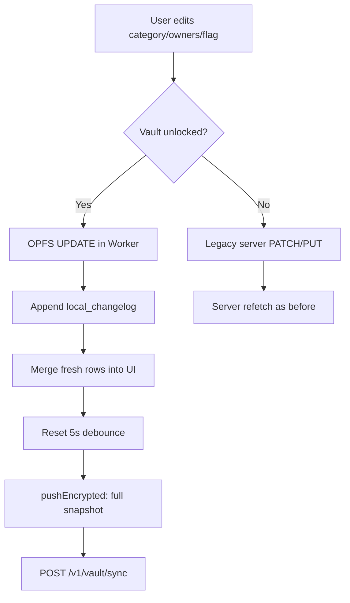
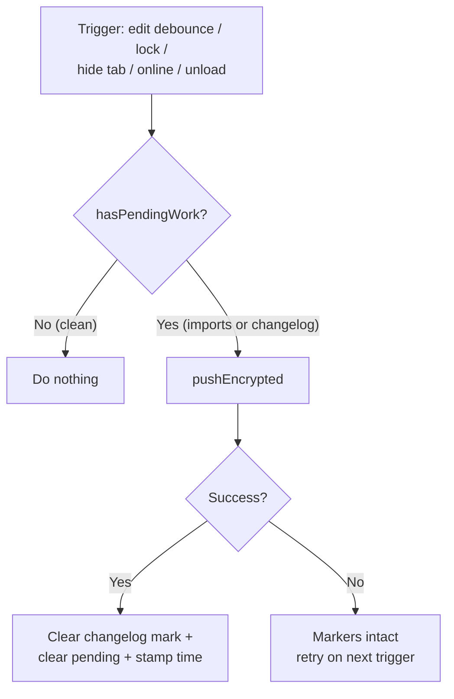
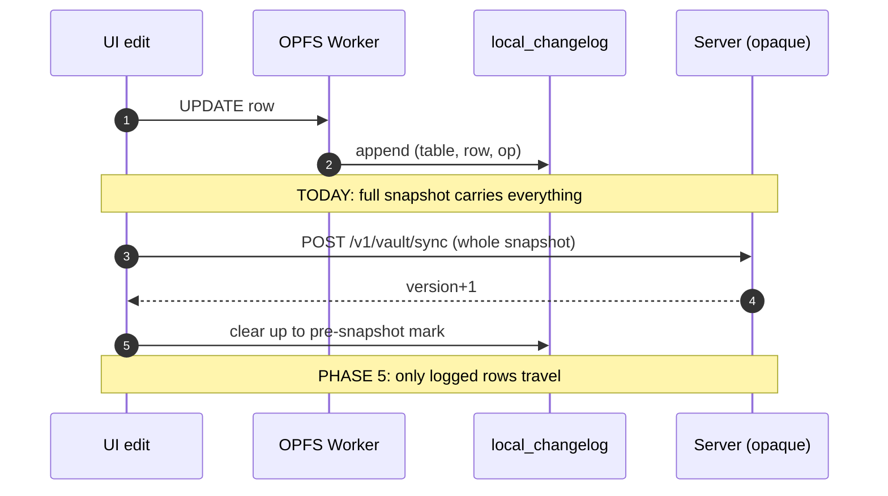
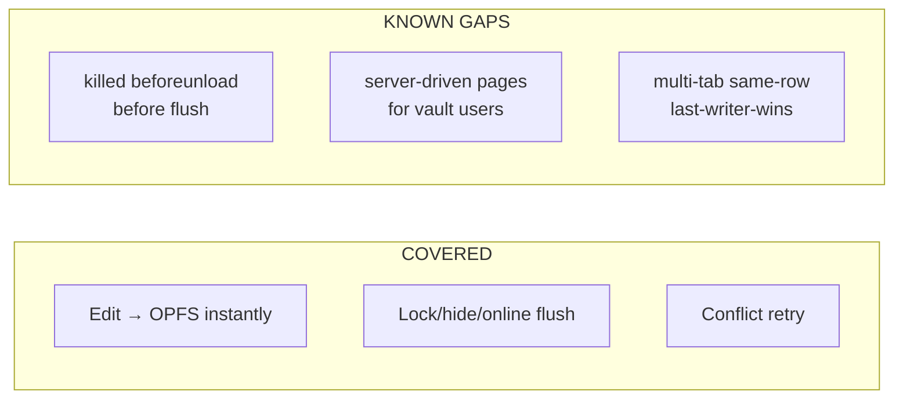

# DONE 003: Sync Cadence, Mutation Layer & Backup Triggers

**Date:** 2026-09-27
**Status:** Shipped on `super-secure`
**Category:** Architecture / Sync / Local-first
**Tags:** `#sync` `#oplog` `#debounce` `#offline` `#local-first`
**Follows:** `002-encrypted-backup-wraps-onboarding.md` (same 🧠 ELI5 convention)

---

## 1. The problem

DONE 002 left three sync holes, all one root cause — the backup timer lived only in memory, and edits had no "awaiting backup" marker (unlike imports, which had `pendingBackup`):

1. **Lock or close the tab within the 5s debounce** → the backup died silently. Edits were safe in durable OPFS, but the backup never happened, with no badge saying so.
2. **Offline edits** → the backup attempt failed and was swallowed. Coming back online triggered nothing by itself.
3. **Category changes bypassed everything** — `PATCH /v1/transactions/:id` sent plaintext edits to the server (a leak for vault users) and left OPFS/vault stale. Reads and imports were local-first; mutations were not.

> 🧠 **ELI5:** we had a diligent secretary who filed every change in the office drawer (OPFS) — but the armored-truck pickup was scheduled on a sticky note that blew away if you closed the window (tab), locked up early, or lost internet. Andworse, some edits were still being phoned in to the old office in plain language. This round: every change is filed *and* logged, the truck comes on a real schedule with backup alarms, and nothing is ever phoned in readable again.

---

## 2. What changed

### 2a. Vault-gated mutation layer (`lib/engine/mutations.ts`)

One rule, enforced in one place: **vault unlocked → edits stay on-device, period.** `useLocalMutations()` reads the in-memory DEK presence; every transaction mutation (single + bulk × category / one-time / owners, on both the transactions page and invoice draft edits) branches through it:

- **Unlocked:** OPFS write via new worker ops (`patchTransaction`, `setOwners` with server-identical equal-split math, `getByIds` for UI merges) → debounced encrypted backup. Server PATCH/PUT **must not fire**.
- **Locked/absent:** legacy server flow, byte-for-byte unchanged.

> 🧠 **ELI5:** a traffic cop at a single intersection. Vault open? All edit-traffic turns left into the private drawer. Vault closed? Traffic goes straight to the old office as before. There is exactly one cop, so the rule can't be bypassed by accident — which is precisely what was happening before, when each page drove straight to the server on its own road.

### 2b. Operation changelog (`local_changelog`)

Every local write appends `(table, row_id, op, timestamp)` — the future incremental sync (Phase 5) will upload only logged rows instead of whole snapshots. Writers: `patchTransaction`, `setOwners` (via shared builders in `opfs-schema.ts`, verified against node:sqlite like everything else). Readers: `getChangelog` / `clearChangelog(upToId)` ops. `pushEncrypted` captures the max id *before* snapshotting (entries written mid-build belong to the next backup) and clears up to its mark on success.

> 🧠 **ELI5:** alongside filing each change, the secretary now keeps a **diary**: "2:14pm — changed row 88's category. 2:15pm — split row 91's owners." Today's truck still takes a photocopy of the whole drawer — but the diary means tomorrow's truck can carry *only the changed pages*. We started writing the diary now so the optimization later is a pure reader change, not a rewrite.

### 2c. Backup triggers (`backup-triggers.ts`, store `lock()`)

The 5s debounce survives for active editing, plus three gap-closers, all gated on `hasPendingWork()` (pending statements OR changelog entries — no pointless full uploads):

- **`lock()` flushes first** (needs the DEK, so it runs *before* seal + wipe), then seals, then wipes. Lock can no longer drop an un-backed-up change.
- **`visibilitychange → hidden`**: switching apps, locking the screen, and most tab closes pass through here while async work can still run — far more reliable than unload handlers.
- **`online` event**: reconnect with pending work → back up now.
- **`beforeunload`**: last-resort floating promise. Documented as best-effort, not a guarantee (the page may die mid-upload) — the durable guarantee remains OPFS itself, and pending markers survive either way.

Pending state is now fully observable: `getPendingWork()` → `{statements[], edits}`; success clears both markers plus records `lastBackupAt`. The vault page shows *"Last backup … • N changes not yet backed up"* / *"everything backed up"*.

> 🧠 **ELI5:** the truck now comes (a) 5 seconds after you stop shuffling papers, (b) every time you lock the office door, (c) every time you look away from the desk, and (d) the moment the road reopens — but only if there's actually anything to carry. And there's a whiteboard by the door showing what's still waiting.

---

## 3. Sync cadence, precisely

| Trigger | When | What uploads | Guarantee |
|---|---|---|---|
| Edit debounce | 5s after last mutation | Full snapshot (all tables) | Timer only; dies with the page |
| `lock()` flush | Before seal + wipe | Full snapshot, if pending work | Strong (awaited, DEK present) |
| Tab hide | `visibilitychange` | Full snapshot, if pending work | Strong in practice |
| Reconnect | `online` event | Full snapshot, if pending work | Strong |
| Tab close | `beforeunload` | Floating attempt | **Best-effort only** |
| Import / manual Sync | Explicit user action | Full snapshot | Strong |

Full snapshots (not deltas) until Phase 5 reads the changelog. At personal-finance scale this is KBs–MBs per backup — acceptable, and the pending-gate means idle devices upload nothing.

---

## 4. Flow diagrams

### 4a. Mutation paths: vault on vs off



> 🧠 **ELI5:** two doors from every edit. Vault open → left door: file it locally, log it in the diary, show it instantly, truck comes in 5 seconds. Vault closed → right door: everything exactly like last year. The doors never mix — that's the whole point.

### 4b. Backup triggers and the pending gate



> 🧠 **ELI5:** before sending the truck, the dispatcher checks the whiteboard. Nothing waiting? Truck stays parked (no empty trips). Something waiting? Load everything, and only wipe the whiteboard *after* the delivery is confirmed. Failed delivery? Whiteboard untouched — the next alarm retries.

### 4c. Changelog lifecycle (today → Phase 5)



> 🧠 **ELI5:** today the diary is written but the truck still photocopies the drawer — the diary just proves nothing was forgotten (and the whiteboard count comes from it). Phase 5 flips it: the truck reads the diary and carries only the listed pages. Because the diary already exists and is already correct, that upgrade touches the reader, not the writers.

### 4d. What staleness remains (honest)



> 🧠 **ELI5:** what's fixed: edits are instant, survive offline, and reach backup through four independent alarms. What's knowingly left: a browser killed mid-unload may skip its last delivery (data safe locally, backup lags); server-computed pages can lag for vault users until reads migrate (plaintext retirement work); two tabs editing the same row resolve by last-writer-wins with no merge view yet.

---

## 5. How to verify

```bash
# Shared-SQL mutation suite vs real SQLite (patch, empty-patch no-op,
# equal split, changelog write + clear)
pnpm --filter @momoney/local-engine build  # then run the *-check scripts
# Manual: unlock vault → recategorize → Network tab shows NO PATCH to
#   /v1/transactions → wait 5s → POST /v1/vault/sync fires → vault page
#   shows "everything backed up" → Lock → OPFS holds .sealed only
# Kill test: edit → lock within 5s → backup still lands (lock flush);
#   edit → go offline → online → backup fires on reconnect
```
