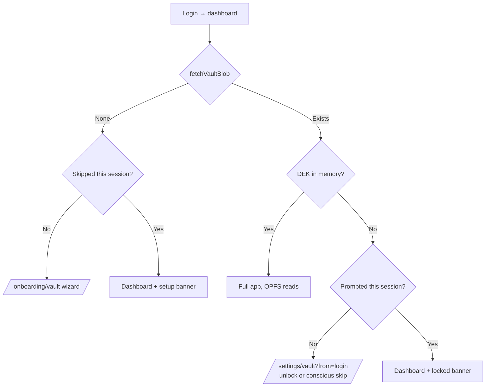
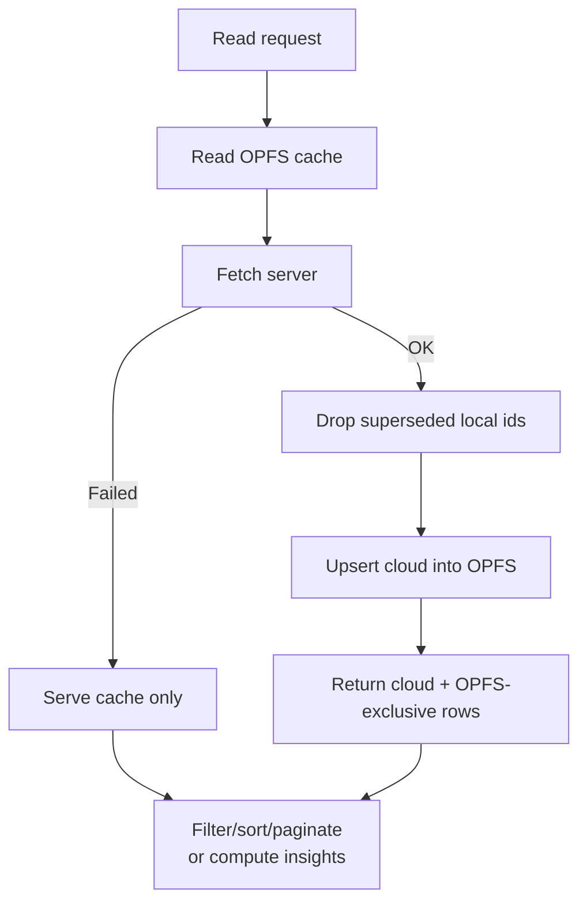
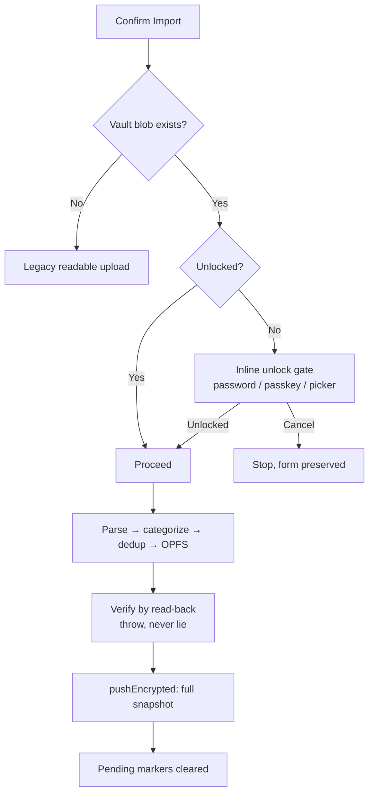

# DONE 004: Unlock Gates, Merged Reads & Worker Hardening

**Date:** 2026-09-27
**Status:** Shipped on `super-secure`
**Category:** Architecture / Correctness / Local-first
**Tags:** `#correctness` `#opfs` `#wa-sqlite` `#ux` `#invariants`
**Follows:** `003-sync-cadence-mutation-layer.md` (same 🧠 ELI5 convention)

> This doc covers everything after DONE 003: the post-login unlock gate, lock-on-logout, the vault-exists-never-plaintext invariant, the merged-read fix that made vault imports visible, restore-on-unlock for new devices, the origin-marker merge fix, and the five-round OPFS worker debugging saga.

---

## 1. Unlock gating: login is not unlock

**Problem:** login (session cookie) and vault unlock (DEK in memory) are separate by design, but the UI treated a locked session as a full session — and worse, logout never locked at all, leaving OPFS unsealed on disk for the next browser-profile reader.

**Changes:**
- `auth.store.logout()` locks first (flush + seal + wipe DEK) *before* signing out, while the DEK still exists.
- Dashboard: vault exists + locked → redirect to `/settings/vault?from=login` once per session (escape hatch back, auto-return after unlock); thereafter a persistent Unlock banner. No vault → existing onboarding flow.
- Statements import: **vault exists ⇒ never plaintext.** A locked vault stops the import with an inline unlock gate (password field / passkey button / device picker) instead of silently taking the legacy readable-upload path. Legacy toasts now say the copy is readable.

> 🧠 **ELI5:** logging in gets you into the building; unlocking opens your safe. We used to let you wander the building bumping into empty shelves without telling you the safe was shut — and when you left, we forgot to lock the filing cabinet. Now the door asks for the combination once, and leaving locks everything behind you.

## 2. Merged reads: neither source alone is complete

**Problem (user-reported: "upload succeeds, Transactions empty"):** with the vault on, new imports live *only* in OPFS while legacy history lives *only* on the server. Analytics returned cloud-only (OPFS-exclusive rows invisible); the transactions list read raw OPFS (server history invisible when it worked at all).

**Changes:**
- `loadLocalInput()` now **unions** both (server canonical, OPFS-exclusive appended; server wins dedupHash collisions) and is exported as `loadMergedInput()` for every reader (transactions store, analytics, dashboard).
- `local-query.ts`: server-faithful filtering (search/dates/category/owner/type/nature/pagination) + UI joins over the merged input.
- Dashboard + insights adapter compute via `localAnalytics` first, server fallback.
- Invoices: local statements/headers merge into lists; full local lifecycle (create/generate/draft/delete, `local-` id prefix) with frozen-item snapshots for generated invoices.

> 🧠 **ELI5:** two filing cabinets that each hold papers the other lacks. Every reader now checks *both* and merges — the office copy wins ties, the drawer copy fills the gaps. Before, each reader picked one cabinet and pretended it was the whole archive.

## 3. Truthful writes + merge-marker fix

- `importStatementLocal` verifies by read-back and **throws** instead of toasting success on worker failure (the old toast lied).
- Statements history merge keyed on the *badge* flag, which encrypted backup clears → backed-up rows duplicated every refresh (duplicate React keys) and deletes 404'd (badge said "server row" for client-UUID ids). Split into permanent `isLocal` origin marker (merge/delete identity) + `localOnly` badge flag (backup state).

> 🧠 **ELI5:** we labeled boxes with sticky notes saying "not yet backed up" — then used the *absence* of the note to mean "came from the office." Boxes lost their notes on backup and got counted twice, and returns got mailed to an office that never sent them. Now every local box is *stamped* at creation (permanent), and the sticky note only means what it says.

## 4. Worker hardening saga (five rounds)

1. **Alias**: `new Worker(new URL('@/workers/…'))` → relative paths (Turbopack can't resolve aliases there).
2. **Boot bytes**: blob-URL workers can't `fetch()` relatively → main thread fetches `wa-sqlite-async.wasm` once, transfers bytes, Emscripten instantiates from memory.
3. **Singleton + serialization**: per-open `Factory()`/`vfs_register()` threw `already registered` and corrupted VFS maps → one API object/VFS per worker lifetime + a promise-queue serializing all ops.
4. **Atomic open + quarantine**: failed opens left stuck handles (`no such table` forever); corrupt leftovers are quarantined to `momoney.db.corrupt-<ts>` (never silently deleted).
5. **Async build (root cause)**: `OriginPrivateFileSystemVFS` methods are async; the sync build coerces returned Promises to ints, so open "succeeded" while registration was pending → every `xRead` hit an empty file map. Switched to the Asyncify build (same API); mechanism verified in Node.

> 🧠 **ELI5:** the bank kept collapsing, and each investigation found a deeper foundation crack: wrong address format → doors with no street to fetch from → two managers registering the same office → a jammed lock left engaged → and finally, the building's wiring (sync) fundamentally couldn't carry the elevator's async cables. Five fixes, each verified, each committed separately so the archaeology reads clean.

## 5. Restore-on-unlock (new-device sync)

Unlock decrypted into React state only — fresh profiles stayed empty despite a healthy blob. All three unlock paths now seed OPFS from the snapshot (idempotent upserts). Plus a vault-page **diagnostics card** (per-table counts, sealed state, pending work, verbatim worker errors) so this failure class is visible instead of silent.

---

## 6. Flow diagrams

### 6a. Post-login routing



### 6b. Merged read (every list/analytics call)



### 6c. Import with the vault invariant



---

## 7. How to verify

```bash
# Fresh profile drill (the user scenario that started this):
# incognito → login → unlock gate → unlock → OPFS seeded →
# Transactions + Insights populated → lock → unlock → still populated
# Kill drill: import → lock within 5s → backup still lands (lock flush)
# Regression: import → backup → refresh 3x → no duplicate keys in history
```
