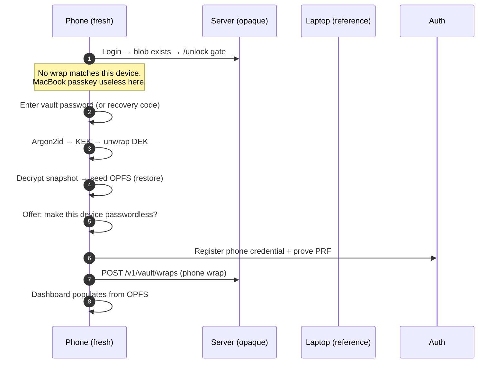
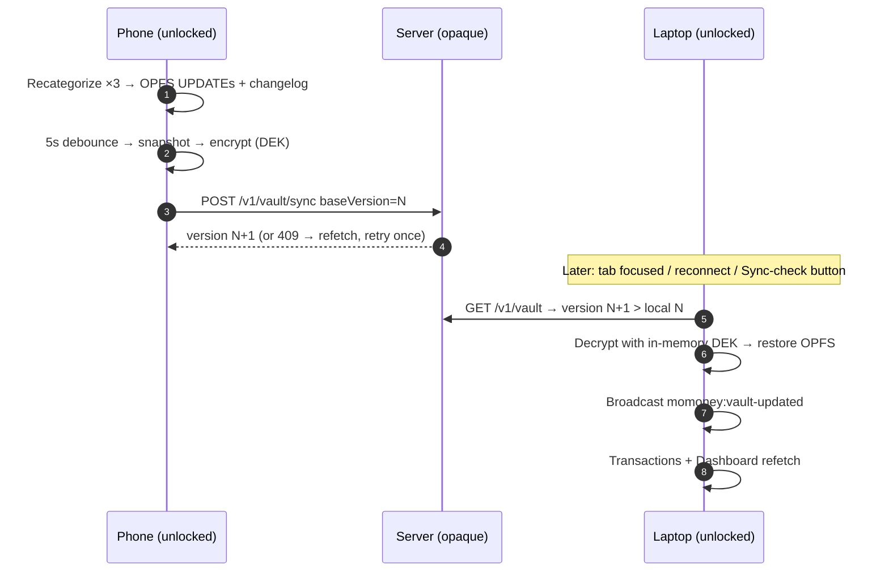

# DONE 005: Cross-Device Sync (laptop → phone → laptop)

**Date:** 2026-09-27
**Status:** Shipped on `super-secure`
**Category:** Architecture / Multi-device / Local-first
**Tags:** `#sync` `#multi-device` `#pull` `#join` `#zero-knowledge`
**Follows:** `004-unlock-gates-merged-reads.md` (same 🧠 ELI5 convention)

> The question this answers: *"I set everything up on my laptop — what exactly happens on
> my phone, and how do phone edits get back to the laptop?"* Every step below is shipped
> code, including the pull path that didn't exist until this doc (unlock decrypted into
> memory only — fresh profiles stayed empty).

---

## 1. Key inventory per device (why joining works)

A vault always has **three independent entries** (mandatory since onboarding v2 — passkey-only vaults can't exist anymore):

| Entry | Scope | Joins new devices? |
|---|---|---|
| Device passkey wrap (`vault_wraps` row) | One device (PRF output is device-bound) | ❌ Only that device |
| Password wrap (`wrapped_dek_password`) | Global (knowledge factor) | ✅ Any device |
| Recovery wrap (`wrapped_dek_recovery`) | Global (knowledge factor) | ✅ Any device, last resort |

> 🧠 **ELI5:** each device gets its own fingerprint-key, but the family shares one written-down password and one emergency code. Lose a phone → revoke its row. Buy a phone → join with the password, then cut it its own fingerprint-key.

---

## 2. Join flow: laptop set up, phone arrives



Steps in code: `UnlockGate` (method detection) → `unlockWithPassword/Recovery` → store restores via `restoreSnapshotToCache` (idempotent upserts) → optional `addPasskey` (`registerPasskey` + wrap POST). The phone never needs the laptop online — the blob + password are sufficient. QR pairing (TODO B4) will make this passwordless later.

> 🧠 **ELI5:** moving into a house your family already lives in. You can't use their fingerprint on the door — but you know the family password, so you're let in, handed a full copy of the filing cabinet, and then cut your own fingerprint-key for tomorrow.

---

## 3. Edit loop: phone change → laptop refresh



Push side: `pushEncrypted` → `syncEncryptedSnapshot` (same DEK across versions until rotation lands — documented assumption). Pull side: store `pullUpdates()` (version compare → decrypt → `restoreSnapshotToCache` → broadcast). Triggers: tab-visible, reconnect, vault-page "Check for updates". Listeners: transactions page + dashboard refetch on the broadcast event.

> 🧠 **ELI5:** the phone files its changes, waits 5 quiet seconds, then mails a fresh locked photocopy of the whole drawer (version-stamped). The laptop, whenever it looks up (tab focus, reconnect, manual check), asks "anything newer than my #N?", and if so downloads, unlocks, restocks its drawer, and shouts down the hallway so every open page refreshes itself.

### Known simplifications (honest)

- **Last-writer-wins across devices.** A push made from a stale base gets one refetch-and-retry — with the *same* snapshot, which overwrites the remote change. True merge is TODO B2; the version guard at least makes overwrites loud (409 first) instead of silent.
- **Same-DEK assumption.** Pull decrypts with the in-memory DEK. After future DEK rotation, a device holding the old DEK will fail decrypt and must re-unlock — the failure path returns `false` (stale view) rather than crashing.
- **Full snapshots both ways.** The changelog is written but not yet read (TODO B1) — syncs cost whole snapshots in both directions.

---

## 4. How to verify

```bash
# Two-profile drill:
# A (main): unlock → import → wait for "Backed up encrypted" (note version)
# B (incognito): login → unlock gate → password → offer add-device →
#   Transactions populated → recategorize one txn → wait ~10s
# A: focus tab → toast-less refresh shows the recategorization (or
#   Settings → Vault → Check for updates → "Pulled changes")
```
