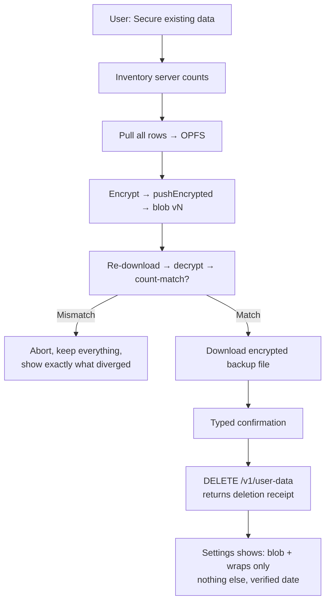

# 006 — Plaintext Migration (BUILT)

**Date:** 2026-09-27 (planned) → **shipped same day**
**Status:** ✅ BUILT — guided backfill, verification receipt, retirement endpoint, backup export/restore, onboarding + settings integration.
**Category:** Privacy / Migration / Local-first
**Tags:** `#backfill` `#retirement` `#migration`
**Follows:** TODO.md Milestone A (this was its detailed breakdown)

---

## 1. Verdict: no stitched path existed — so we built it (see §5)

~~What exists are~~ What existed were **four unconnected primitives**, not a path:

| Primitive | What it does | What it does NOT do |
|---|---|---|
| Onboarding setup encrypts "current OPFS" | Covers whatever happens to be cached | Guarantee the cache holds all server history (fresh device ≈ empty) |
| Lazy convergence (`loadMergedInput`) | Server rows drift into OPFS over days of usage | Verify completeness, or ever finish on a deadline |
| `pushEncrypted` | Backs up OPFS as ciphertext | Delete, or even enumerate, what's still plaintext on the server |
| Per-statement delete | Removes one server statement | Bulk retirement; any verification |

And two structural gaps: the vault snapshot has **no net-worth tables** (`assets`, `liabilities`, drafts/snapshots can't enter the vault at all), and **no endpoint deletes plaintext in bulk**. So today, "migrating" means hoping convergence finishes before anything bad happens, while the originals sit on the server forever.

> 🧠 **ELI5:** moving house requires three steps — pack every box, verify nothing was left behind, hand back the old keys. Today we pack whatever happens to be lying around, never check the attic, and keep paying rent on the old place indefinitely.

---

## 2. Build plan (in dependency order)

> Executed as written. Deviations: no maintenance-freeze flag (concurrent-device drift during migration surfaces as a count mismatch → retry, per §6); no server-side retired marker (localStorage per browser); bulk pull capped at 500k rows with progress UI.

### Phase 0 — widen the snapshot (prerequisite)
Add `assets`, `liabilities`, `netWorthSnapshots`, `netWorthDrafts` to `VaultSnapshot`, OPFS tables + builders, and cache them in `fetchCloudInput`. Without this, "migrate everything" silently skips net worth — the worst kind of partial migration. (Also pull rules/merchants/owners/accounts pickers off direct server fetches, or document them as metadata-exempt with justification.)

### Phase 1 — guided backfill flow ("Secure existing data")
Offered in onboarding when server rows exist, and anytime in Settings → Vault. Steps, each gated on the last:
1. **Inventory**: count server rows per table (`SELECT count(*)` — cheap, no bulk fetch yet). Show: "2,314 transactions, 41 statements, … will be encrypted."
2. **Pull**: page everything into OPFS (reuse `fetchCloudInput`, unbounded — drop the 10k cap here or chunk it with progress UI).
3. **Encrypt + push**: `pushEncrypted()` as today.
4. **Verify**: re-download the blob, decrypt, compare counts table-by-table. Show a **receipt**: "2,314/2,314 transactions • decrypt round-trip OK • blob v7".
5. Only then unlock Phase 2.

### Phase 2 — independent restore path (safety before deletion)
"Download encrypted backup" button: exports the raw `vault_blobs` row as a file the user keeps. Deletion without an independent restore path is a single-point-of-failure ceremony — this file is the parachute (importable later via a symmetric "Restore from file" that PUTs it back).

### Phase 3 — retirement endpoint + ceremony
- `DELETE /v1/user-data` (new, dangerous): deletes all content-bearing server rows for the user (transactions, statements, invoices + items, rules?, merchants?, assets/liabilities — explicit table list in code, never `CASCADE`-and-pray), requires: unlocked vault + verified backfill receipt ID + typed confirmation ("delete my server data").
- Returns a deletion receipt (per-table counts). UI shows it permanently in Settings ("Server holds: vault blob v7 + 2 wraps. Nothing else. Verified <date>.").

### Phase 4 — steady-state enforcement
- Reads already prefer OPFS; after retirement, server fallbacks return empty — add explicit "retired" state (from a `serverEmptiedAt` marker, stored where? `vault_blobs` column or localStorage) so empty-server is distinguishable from offline/broken.
- Post-retirement imports with vault unlocked already never create plaintext (invariant, shipped). Post-retirement imports with vault *locked* hit the vault gate (shipped) — no new plaintext can appear. Close the loop in copy.

---

## 3. Flow diagram (target state)

> 🧠 **ELI5:** count everything in the old house → move it all → lock it in the safe → drive back and recount from the safe's copy → only then burn the old lease papers, while keeping a spare safe-key-file with a friend. Any step can say "stop, something doesn't match" and nothing is lost.

---

## 5. What shipped (same day)

- **Phase 0**: `assets/liabilities/netWorthSnapshots/netWorthDrafts` in `VaultSnapshot`, OPFS tables + shared builders (node:sqlite-verified), `fetchCloudInput` caching, `emptyCache()` canonicalizer.
- **Phase 1**: `MigrationWizard` (inventory → pull with progress → encrypt/push → decrypt + count-match receipt), wired into onboarding (recovery gate → migrate when server rows exist) with plain-terms copy.
- **Phase 2**: encrypted backup download + restore-from-file in Settings → Vault.
- **Phase 3**: `DELETE /v1/vault/user-data` (vault-required, typed `DELETE` confirmation, ordered deletes honoring non-cascading FKs, per-table counts; system rows untouched) + typed-confirm UI + permanent deletion receipt + retired marker. E2E covers unconfirmed/vault-less rejection.
- Residual notes: pickers (rules/owners/accounts/categories) still fetch server directly (cached copies exist; acceptable — metadata, converged); `serverEmptiedAt` marker lives in localStorage per browser (a server-side marker is future work if multi-device retired-state sync matters).

---

## 6. Risks (kept from the plan — still apply to future migrations)

- **Verification before deletion is non-negotiable.** Count-match + decrypt round-trip, or no delete button. A migration that can't prove itself is a data-loss machine.
- **Net worth must ride along** (Phase 0) or the receipt lies by omission.
- **Concurrent devices mid-migration**: a second device pushing during Phase 1 changes counts — freeze writes during migration (maintenance flag on the vault row) or re-verify in a loop until two consecutive matches.
- **The export file is itself sensitive-adjacent**: it's ciphertext (safe to store anywhere), but label it clearly — losing it *and* the password *and* the passkey is still game over.
